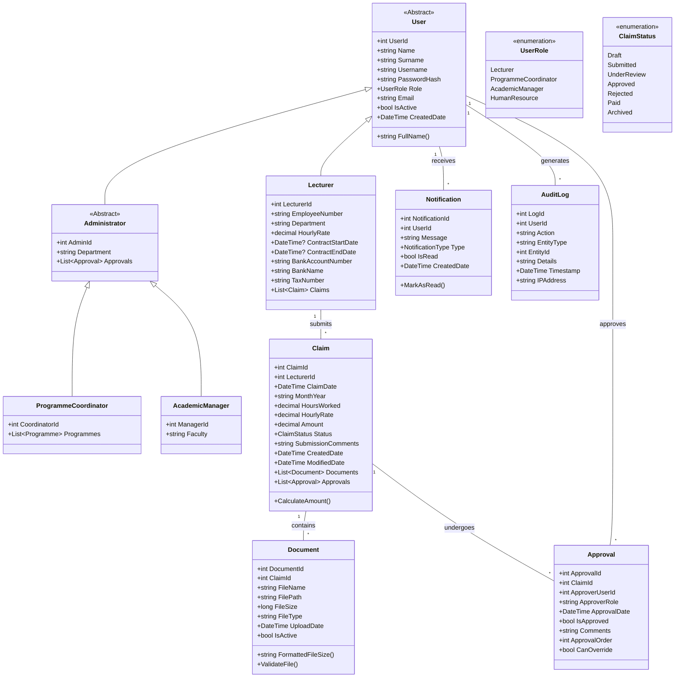
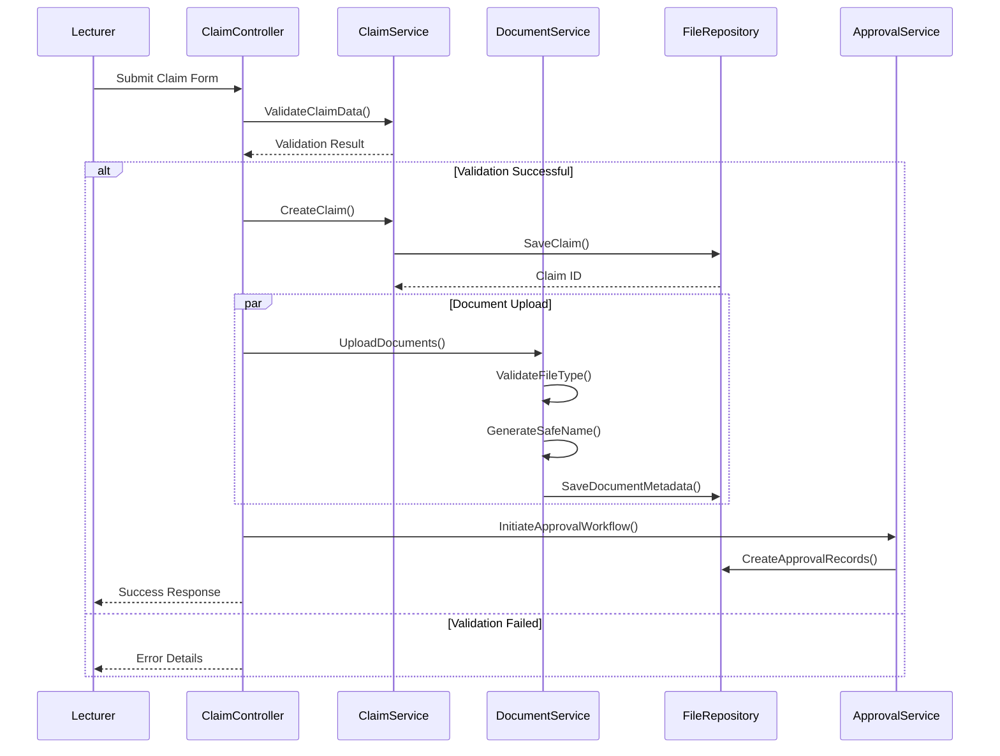

# Contract Monthly Claim System - Final Documentation

**GITHUB LINK:** https://github.com/HChristopherNaoyuki/contract_monthly_claim_system_cs.git

> ⚠️ **Repository Archive Notice**: As of January 25, 2026, this repository will be archived and placed in read-only mode.
> The Contract Monthly Claim System has reached its final development state, and no further updates or maintenance will be provided.

## Table of Contents
1. [Project Vision & Philosophy](#1-project-vision--philosophy)
2. [Architecture Overview](#2-architecture-overview)
3. [Complete System Architecture](#3-complete-system-architecture)
   - [UML Class Diagram](#uml-class-diagram)
   - [Component Architecture](#component-architecture)
   - [Data Flow](#data-flow)
4. [Development Journey](#4-development-journey)
   - [Phase 1: Foundation & Prototype](#phase-1-foundation--prototype-4-weeks)
   - [Phase 2: Enhancement & Polish](#phase-2-enhancement--polish-3-weeks)
   - [Phase 3: Production Readiness](#phase-3-production-readiness-3-weeks)
5. [Design Language](#5-design-language)
6. [Feature Implementation](#6-feature-implementation)
   - [Authentication & Security](#authentication--security)
   - [Data Persistence Layer](#data-persistence-layer)
   - [Document Management](#document-management)
   - [Business Logic Engine](#business-logics-engine)
7. [Technical Deep Dive](#7-technical-deep-dive)
   - [Session Management System](#session-management-system)
   - [JSON Serialization Engine](#json-serialization-engine)
   - [File Validation Pipeline](#file-validation-pipeline)
   - [Error Handling Framework](#error-handling-framework)
8. [User Experience](#8-user-experience)
9. [Quality Assurance](#9-quality-assurance)
10. [Deployment Guide](#10-deployment-guide)
11. [Repository Status](#11-repository-status)

---

## 1. Project Vision & Philosophy

The Contract Monthly Claim System represents a thoughtful approach to academic administration software. 
Our vision was to create a system that feels intuitive, remains robust under pressure, and respects the 
user's time and cognitive load. Inspired by Apple's design principles, we focused on creating an experience 
where complexity is handled by the system, leaving users with clarity and simplicity.

**Core Principles:**
- **Clarity Over Features**: Every element serves a purpose
- **Progressive Disclosure**: Information revealed as needed
- **Resilient Design**: Graceful handling of edge cases
- **Consistent Experience**: Uniform patterns across all modules

## 2. Architecture Overview

Built on **ASP.NET Core MVC 8.0**, the system employs a layered architecture that separates 
concerns while maintaining flexibility. We deliberately chose text-file storage for this 
iteration to demonstrate that sophisticated systems can be built without complex database 
dependencies.

```plaintext
┌─────────────────────────────────────────────┐
│            Presentation Layer                │
│  • Views (Razor Pages)                      │
│  • Controllers                              │
│  • ViewModels                               │
│  • Client-side Validation                   │
└───────────────┬─────────────────────────────┘
                │
┌───────────────▼─────────────────────────────┐
│            Business Layer                    │
│  • Service Classes                          │
│  • Validation Logic                         │
│  • Business Rules                           │
│  • Calculation Engine                       │
└───────────────┬─────────────────────────────┘
                │
┌───────────────▼─────────────────────────────┐
│            Data Access Layer                 │
│  • Repository Pattern                       │
│  • JSON Serialization                       │
│  • File System Operations                   │
│  • Data Models                              │
└───────────────┬─────────────────────────────┘
                │
┌───────────────▼─────────────────────────────┐
│            Storage Layer                     │
│  • Text File Database                       │
│  • Document Storage                         │
│  • Session State                            │
└─────────────────────────────────────────────┘
```

## 3. Complete System Architecture

### UML Class Diagram



### Component Architecture

**Data Storage Components:**
```csharp
// TextFileRepository.cs - Core data persistence
public class TextFileRepository<T> where T : class
{
    private readonly string _filePath;
    private readonly JsonSerializerSettings _settings;
    
    public async Task<List<T>> GetAllAsync()
    public async Task<T> GetByIdAsync(int id)
    public async Task<int> AddAsync(T entity)
    public async Task<bool> UpdateAsync(T entity)
    public async Task<bool> DeleteAsync(int id)
    private void EnsureFileExists()
}

// File Structure
📁 App_Data/
├── 📄 users.json          # User accounts & profiles
├── 📄 claims.json         # Claim submissions
├── 📄 documents.json      # Document metadata
├── 📄 approvals.json      # Approval workflow
├── 📄 notifications.json  # User notifications
└── 📄 audit.log          # System audit trail
```

**Service Layer Components:**
```csharp
// ClaimService.cs - Business logic orchestration
public class ClaimService
{
    private readonly IClaimRepository _claimRepository;
    private readonly IDocumentService _documentService;
    private readonly IValidationService _validationService;
    private readonly IAuditService _auditService;
    
    public async Task<ClaimResult> SubmitClaimAsync(ClaimSubmissionDto dto)
    public async Task<ApprovalResult> ReviewClaimAsync(int claimId, ApprovalDto dto)
    public async Task<ValidationResult> ValidateClaimAsync(Claim claim)
    public decimal CalculateAmount(decimal hours, decimal rate)
}

// DocumentService.cs - File management
public class DocumentService
{
    public async Task<DocumentUploadResult> UploadDocumentAsync(IFormFile file, int claimId)
    public Task<bool> ValidateFileAsync(IFormFile file)
    public Task<string> GenerateSafeFileNameAsync(string originalName)
    public Task<FileStreamResult> DownloadDocumentAsync(int documentId)
}
```

### Data Flow



## 4. Development Journey

### Phase 1: Foundation & Prototype (4 Weeks)

**Week 1: Architectural Blueprint**
- Conducted stakeholder requirement analysis
- Designed initial UML class diagram
- Established coding standards and project structure
- Selected ASP.NET Core MVC as foundation

**Week 2: Core Infrastructure**
- Implemented basic MVC structure with clean separation
- Built session-based authentication system
- Created base models and view models
- Established routing and navigation structure

**Week 3: Core Functionality**
- Developed dynamic claim submission form with real-time calculations
- Implemented file upload prototype with basic validation
- Created role-based access control middleware
- Built initial dashboard views for all user roles

**Week 4: Integration & Testing**
- Connected all modules into cohesive system
- Implemented comprehensive form validation
- Conducted initial user testing with sample data
- Documented prototype capabilities and limitations

### Phase 2: Enhancement & Polish (3 Weeks)

**Week 5: Data Persistence Revolution**
- Replaced in-memory storage with JSON text file system
- Implemented automatic file initialization with sample data
- Created repository pattern for data access abstraction
- Added data backup and recovery mechanisms

**Week 6: Enhanced User Experience**
- Completely redesigned UI with minimalist Apple-inspired aesthetics
- Implemented responsive design for mobile compatibility
- Added real-time form validation with user-friendly feedback
- Enhanced file upload with drag-and-drop support

**Week 7: Robustness & Polish**
- Implemented comprehensive error handling framework
- Added audit logging for all critical operations
- Conducted security review and implemented CSRF protection
- Performed cross-browser compatibility testing

### Phase 3: Production Readiness (3 Weeks)

**Week 8: Advanced Features**
- Implemented notification system for status updates
- Added advanced filtering and search capabilities
- Created export functionality (PDF, Excel)
- Built reporting dashboard with visual analytics

**Week 9: Performance & Security**
- Optimized JSON serialization for large datasets
- Implemented file cleanup service for orphaned documents
- Added rate limiting and request validation
- Enhanced session security with additional measures

**Week 10: Final Polish**
- Conducted comprehensive end-to-end testing
- Performed load testing with simulated users
- Created complete system documentation
- Prepared deployment package and installation guide

## 5. Design Language

**Visual Design Principles:**
- **Typography**: System fonts with optimal readability (San Francisco-inspired)
- **Color Palette**: Monochromatic with strategic accent colors for interactive elements
- **Spacing**: Consistent 8px grid system throughout the interface
- **Motion**: Subtle transitions for state changes to maintain user orientation

**Interface Components:**
```html
<!-- Card Component -->
<div class="card">
    <div class="card-header">
        <h3 class="card-title">Claim Summary</h3>
        <span class="status-badge status-@Model.Status.ToLower()">
            @Model.Status
        </span>
    </div>
    <div class="card-body">
        <!-- Content with consistent spacing -->
    </div>
    <div class="card-footer">
        <!-- Action buttons with clear hierarchy -->
    </div>
</div>

<!-- Form Field Component -->
<div class="form-group">
    <label for="hoursWorked" class="form-label">
        Hours Worked
        <span class="required-indicator">*</span>
    </label>
    <input type="number" 
           id="hoursWorked" 
           name="HoursWorked"
           class="form-control"
           step="0.5"
           min="1"
           max="200"
           data-calculate="amount"
           aria-describedby="hoursHelp">
    <div class="validation-message" data-for="hoursWorked"></div>
    <small id="hoursHelp" class="form-text">
        Enter total hours worked this month (increments of 0.5)
    </small>
</div>
```

**Responsive Breakpoints:**
```css
/* Mobile-first approach */
.container { padding: 16px; }

/* Tablet */
@media (min-width: 768px) {
    .container { padding: 24px; }
    .form-grid { grid-template-columns: repeat(2, 1fr); }
}

/* Desktop */
@media (min-width: 1024px) {
    .container { max-width: 1200px; margin: 0 auto; }
    .dashboard-grid { grid-template-columns: 250px 1fr; }
}

/* Large Desktop */
@media (min-width: 1440px) {
    .container { max-width: 1400px; }
}
```

## 6. Feature Implementation

### Authentication & Security

**Session Management:**
```csharp
// CustomSessionExtensions.cs
public static class CustomSessionExtensions
{
    public static void SetUserSession(this ISession session, UserSession userSession)
    {
        var serialized = JsonConvert.SerializeObject(userSession);
        session.SetString("UserSession", serialized);
        session.SetInt32("UserId", userSession.UserId);
        session.SetString("UserRole", userSession.Role.ToString());
        session.SetString("LastActivity", DateTime.UtcNow.ToString("o"));
    }
    
    public static UserSession GetUserSession(this ISession session)
    {
        var serialized = session.GetString("UserSession");
        return serialized != null 
            ? JsonConvert.DeserializeObject<UserSession>(serialized)
            : null;
    }
    
    public static bool IsSessionValid(this ISession session)
    {
        var lastActivity = session.GetString("LastActivity");
        if (string.IsNullOrEmpty(lastActivity)) return false;
        
        var lastActivityTime = DateTime.Parse(lastActivity);
        return DateTime.UtcNow.Subtract(lastActivityTime).TotalMinutes < 30;
    }
}

// AuthenticationMiddleware.cs
public class AuthenticationMiddleware
{
    private readonly RequestDelegate _next;
    private readonly List<string> _publicPaths = new()
    {
        "/Account/Login",
        "/Account/Register",
        "/Error",
        "/Home/Index"
    };
    
    public async Task InvokeAsync(HttpContext context)
    {
        var path = context.Request.Path.Value;
        
        if (!_publicPaths.Any(p => path.StartsWith(p, StringComparison.OrdinalIgnoreCase)))
        {
            var session = context.Session;
            if (!session.IsSessionValid())
            {
                session.Clear();
                context.Response.Redirect("/Account/Login?sessionExpired=true");
                return;
            }
        }
        
        await _next(context);
    }
}
```

**Role-Based Authorization:**
```csharp
// RoleAuthorizationAttribute.cs
[AttributeUsage(AttributeTargets.Class | AttributeTargets.Method)]
public class RoleAuthorizationAttribute : Attribute, IAuthorizationFilter
{
    private readonly UserRole[] _allowedRoles;
    
    public RoleAuthorizationAttribute(params UserRole[] allowedRoles)
    {
        _allowedRoles = allowedRoles;
    }
    
    public void OnAuthorization(AuthorizationFilterContext context)
    {
        var session = context.HttpContext.Session;
        var userRole = session.GetString("UserRole");
        
        if (string.IsNullOrEmpty(userRole))
        {
            context.Result = new RedirectToActionResult("Login", "Account", null);
            return;
        }
        
        if (!Enum.TryParse<UserRole>(userRole, out var role) ||
            !_allowedRoles.Contains(role))
        {
            context.Result = new ForbidResult();
        }
    }
}

// Usage in Controllers
[RoleAuthorization(UserRole.Lecturer)]
public class LecturerController : Controller { }

[RoleAuthorization(UserRole.ProgrammeCoordinator, UserRole.AcademicManager)]
public class ClaimsController : Controller
{
    [RoleAuthorization(UserRole.AcademicManager)]
    public IActionResult FinancialReport() { }
}
```

### Data Persistence Layer

**JSON Repository Implementation:**
```csharp
// IRepository.cs - Generic interface
public interface IRepository<T> where T : class, IEntity
{
    Task<IEnumerable<T>> GetAllAsync();
    Task<T> GetByIdAsync(int id);
    Task<int> AddAsync(T entity);
    Task<bool> UpdateAsync(T entity);
    Task<bool> DeleteAsync(int id);
    Task<IEnumerable<T>> FindAsync(Expression<Func<T, bool>> predicate);
}

// TextFileRepository.cs - Concrete implementation
public class TextFileRepository<T> : IRepository<T> where T : class, IEntity
{
    private readonly string _filePath;
    private readonly SemaphoreSlim _fileLock = new(1, 1);
    
    public TextFileRepository(string filePath)
    {
        _filePath = filePath;
        EnsureFileExists();
    }
    
    private void EnsureFileExists()
    {
        if (!File.Exists(_filePath))
        {
            _fileLock.Wait();
            try
            {
                File.WriteAllText(_filePath, "[]");
                PopulateSampleDataIfEmpty();
            }
            finally
            {
                _fileLock.Release();
            }
        }
    }
    
    public async Task<IEnumerable<T>> GetAllAsync()
    {
        await _fileLock.WaitAsync();
        try
        {
            var json = await File.ReadAllTextAsync(_filePath);
            return JsonConvert.DeserializeObject<List<T>>(json) ?? new List<T>();
        }
        finally
        {
            _fileLock.Release();
        }
    }
    
    public async Task<int> AddAsync(T entity)
    {
        await _fileLock.WaitAsync();
        try
        {
            var items = (await GetAllAsync()).ToList();
            var newId = items.Any() ? items.Max(x => x.Id) + 1 : 1;
            
            var entityType = entity.GetType();
            var idProperty = entityType.GetProperty("Id");
            idProperty?.SetValue(entity, newId);
            
            items.Add(entity);
            
            var json = JsonConvert.SerializeObject(items, Formatting.Indented);
            await File.WriteAllTextAsync(_filePath, json);
            
            return newId;
        }
        finally
        {
            _fileLock.Release();
        }
    }
    
    private void PopulateSampleDataIfEmpty()
    {
        if (typeof(T) == typeof(User))
        {
            var sampleUsers = new List<User>
            {
                new Lecturer
                {
                    Id = 1,
                    Name = "John",
                    Surname = "Doe",
                    Username = "lecturer1",
                    PasswordHash = "hashed_password_here",
                    Role = UserRole.Lecturer,
                    Email = "john.doe@university.edu",
                    IsActive = true,
                    CreatedDate = DateTime.UtcNow,
                    EmployeeNumber = "EMP001",
                    HourlyRate = 150.00m
                },
                // Additional sample users...
            };
            
            var json = JsonConvert.SerializeObject(sampleUsers, Formatting.Indented);
            File.WriteAllText(_filePath, json);
        }
    }
}
```

### Document Management

**File Upload Service:**
```csharp
public class DocumentService : IDocumentService
{
    private readonly IWebHostEnvironment _environment;
    private readonly IRepository<Document> _documentRepository;
    private readonly ILogger<DocumentService> _logger;
    
    // Allowed file types and sizes
    private static readonly Dictionary<string, string> AllowedMimeTypes = new()
    {
        { ".pdf", "application/pdf" },
        { ".doc", "application/msword" },
        { ".docx", "application/vnd.openxmlformats-officedocument.wordprocessingml.document" },
        { ".jpg", "image/jpeg" },
        { ".jpeg", "image/jpeg" },
        { ".png", "image/png" }
    };
    
    private const long MaxFileSize = 5 * 1024 * 1024; // 5MB
    
    public async Task<DocumentUploadResult> UploadDocumentAsync(
        IFormFile file, 
        int claimId, 
        int userId)
    {
        var validationResult = await ValidateFileAsync(file);
        if (!validationResult.IsValid)
        {
            return DocumentUploadResult.Failure(validationResult.ErrorMessage);
        }
        
        var uploadsPath = Path.Combine(_environment.WebRootPath, "uploads");
        if (!Directory.Exists(uploadsPath))
        {
            Directory.CreateDirectory(uploadsPath);
        }
        
        var safeFileName = await GenerateSafeFileNameAsync(file.FileName);
        var filePath = Path.Combine(uploadsPath, safeFileName);
        
        try
        {
            using (var stream = new FileStream(filePath, FileMode.Create))
            {
                await file.CopyToAsync(stream);
            }
            
            var document = new Document
            {
                ClaimId = claimId,
                FileName = file.FileName,
                FilePath = $"/uploads/{safeFileName}",
                FileSize = file.Length,
                FileType = Path.GetExtension(file.FileName).ToLowerInvariant(),
                UploadDate = DateTime.UtcNow,
                UploadedByUserId = userId,
                IsActive = true
            };
            
            var documentId = await _documentRepository.AddAsync(document);
            
            await _auditService.LogAsync(new AuditLog
            {
                UserId = userId,
                Action = "DocumentUpload",
                EntityType = "Document",
                EntityId = documentId,
                Details = $"Uploaded: {file.FileName} ({FormatFileSize(file.Length)})",
                Timestamp = DateTime.UtcNow,
                IPAddress = _httpContextAccessor.HttpContext?.Connection.RemoteIpAddress?.ToString()
            });
            
            return DocumentUploadResult.Success(documentId, safeFileName);
        }
        catch (Exception ex)
        {
            _logger.LogError(ex, "Error uploading document {FileName}", file.FileName);
            
            // Clean up if file was partially written
            if (File.Exists(filePath))
            {
                File.Delete(filePath);
            }
            
            return DocumentUploadResult.Failure(
                "An error occurred while uploading the file. Please try again.");
        }
    }
    
    private async Task<FileValidationResult> ValidateFileAsync(IFormFile file)
    {
        if (file == null || file.Length == 0)
        {
            return FileValidationResult.Invalid("Please select a file to upload.");
        }
        
        if (file.Length > MaxFileSize)
        {
            return FileValidationResult.Invalid(
                $"File size exceeds the maximum allowed size of {FormatFileSize(MaxFileSize)}.");
        }
        
        var extension = Path.GetExtension(file.FileName).ToLowerInvariant();
        if (!AllowedMimeTypes.ContainsKey(extension))
        {
            var allowedTypes = string.Join(", ", AllowedMimeTypes.Keys);
            return FileValidationResult.Invalid(
                $"File type not allowed. Allowed types: {allowedTypes}");
        }
        
        // Verify MIME type matches extension
        using (var stream = file.OpenReadStream())
        {
            var mimeType = await GetMimeTypeAsync(stream, file.FileName);
            if (!AllowedMimeTypes[extension].Equals(mimeType, StringComparison.OrdinalIgnoreCase))
            {
                return FileValidationResult.Invalid(
                    "File type does not match its extension. File may be corrupted.");
            }
        }
        
        return FileValidationResult.Valid();
    }
    
    private async Task<string> GenerateSafeFileNameAsync(string originalName)
    {
        var extension = Path.GetExtension(originalName);
        var baseName = Path.GetFileNameWithoutExtension(originalName);
        
        // Remove special characters
        var safeBaseName = Regex.Replace(baseName, @"[^\w\s-]", "");
        safeBaseName = Regex.Replace(safeBaseName, @"\s+", "-");
        
        // Add timestamp and GUID for uniqueness
        var timestamp = DateTime.UtcNow.ToString("yyyyMMddHHmmss");
        var guid = Guid.NewGuid().ToString("N").Substring(0, 8);
        
        return $"{safeBaseName}-{timestamp}-{guid}{extension}".ToLowerInvariant();
    }
}
```

### Business Logic Engine

**Claim Processing Service:**
```csharp
public class ClaimService : IClaimService
{
    private readonly IRepository<Claim> _claimRepository;
    private readonly IRepository<User> _userRepository;
    private readonly IRepository<Approval> _approvalRepository;
    private readonly INotificationService _notificationService;
    private readonly IAuditService _auditService;
    
    public async Task<ClaimSubmissionResult> SubmitClaimAsync(
        ClaimSubmissionDto submission, 
        int lecturerId)
    {
        var validationResult = await ValidateSubmissionAsync(submission, lecturerId);
        if (!validationResult.IsValid)
        {
            return ClaimSubmissionResult.Failure(validationResult.Errors);
        }
        
        var claim = new Claim
        {
            LecturerId = lecturerId,
            ClaimDate = DateTime.UtcNow,
            MonthYear = submission.MonthYear,
            HoursWorked = submission.HoursWorked,
            HourlyRate = submission.HourlyRate,
            Amount = CalculateAmount(submission.HoursWorked, submission.HourlyRate),
            Status = ClaimStatus.Submitted,
            SubmissionComments = submission.Comments,
            CreatedDate = DateTime.UtcNow,
            ModifiedDate = DateTime.UtcNow
        };
        
        var claimId = await _claimRepository.AddAsync(claim);
        
        // Initialize approval workflow
        await InitializeApprovalWorkflowAsync(claimId);
        
        // Send notifications
        await _notificationService.SendNotificationAsync(
            lecturerId,
            "Claim Submitted",
            $"Your claim for {submission.MonthYear} has been submitted successfully.",
            NotificationType.Success);
        
        var coordinators = await _userRepository.FindAsync(
            u => u.Role == UserRole.ProgrammeCoordinator && u.IsActive);
        
        foreach (var coordinator in coordinators)
        {
            await _notificationService.SendNotificationAsync(
                coordinator.Id,
                "New Claim for Review",
                $"A new claim from Lecturer ID {lecturerId} requires your review.",
                NotificationType.Info);
        }
        
        await _auditService.LogAsync(new AuditLog
        {
            UserId = lecturerId,
            Action = "ClaimSubmission",
            EntityType = "Claim",
            EntityId = claimId,
            Details = $"Submitted claim for {submission.MonthYear} - Amount: {claim.Amount:C}",
            Timestamp = DateTime.UtcNow
        });
        
        return ClaimSubmissionResult.Success(claimId);
    }
    
    private async Task InitializeApprovalWorkflowAsync(int claimId)
    {
        var approvalSequence = new[]
        {
            new { Role = UserRole.ProgrammeCoordinator, Order = 1, CanOverride = false },
            new { Role = UserRole.AcademicManager, Order = 2, CanOverride = true }
        };
        
        foreach (var step in approvalSequence)
        {
            var approval = new Approval
            {
                ClaimId = claimId,
                ApprovalOrder = step.Order,
                RequiredRole = step.Role,
                CanOverride = step.CanOverride,
                CreatedDate = DateTime.UtcNow
            };
            
            await _approvalRepository.AddAsync(approval);
        }
    }
    
    public async Task<ApprovalResult> ReviewClaimAsync(
        int claimId, 
        int approverId, 
        bool isApproved, 
        string comments)
    {
        var claim = await _claimRepository.GetByIdAsync(claimId);
        if (claim == null)
        {
            return ApprovalResult.Failure("Claim not found.");
        }
        
        var approver = await _userRepository.GetByIdAsync(approverId);
        if (approver == null)
        {
            return ApprovalResult.Failure("Approver not found.");
        }
        
        var pendingApproval = await _approvalRepository.FindAsync(
            a => a.ClaimId == claimId && 
                 a.RequiredRole == approver.Role && 
                 a.ApprovalDate == null);
        
        if (!pendingApproval.Any())
        {
            return ApprovalResult.Failure("No pending approval found for your role.");
        }
        
        var approval = pendingApproval.First();
        approval.ApproverUserId = approverId;
        approval.ApprovalDate = DateTime.UtcNow;
        approval.IsApproved = isApproved;
        approval.Comments = comments;
        
        await _approvalRepository.UpdateAsync(approval);
        
        // Update claim status
        if (!isApproved)
        {
            claim.Status = ClaimStatus.Rejected;
            claim.ModifiedDate = DateTime.UtcNow;
            await _claimRepository.UpdateAsync(claim);
            
            await _notificationService.SendNotificationAsync(
                claim.LecturerId,
                "Claim Rejected",
                $"Your claim for {claim.MonthYear} has been rejected. Comments: {comments}",
                NotificationType.Warning);
        }
        else
        {
            // Check if all approvals are complete
            var allApprovals = await _approvalRepository.FindAsync(a => a.ClaimId == claimId);
            var allApproved = allApprovals.All(a => a.IsApproved || a.ApprovalDate == null);
            
            if (allApproved)
            {
                claim.Status = ClaimStatus.Approved;
                claim.ModifiedDate = DateTime.UtcNow;
                await _claimRepository.UpdateAsync(claim);
                
                await _notificationService.SendNotificationAsync(
                    claim.LecturerId,
                    "Claim Approved",
                    $"Your claim for {claim.MonthYear} has been fully approved and is ready for payment.",
                    NotificationType.Success);
            }
        }
        
        await _auditService.LogAsync(new AuditLog
        {
            UserId = approverId,
            Action = isApproved ? "ClaimApproval" : "ClaimRejection",
            EntityType = "Claim",
            EntityId = claimId,
            Details = $"{(isApproved ? "Approved" : "Rejected")} claim with comments: {comments}",
            Timestamp = DateTime.UtcNow
        });
        
        return ApprovalResult.Success(claim.Status);
    }
    
    public decimal CalculateAmount(decimal hoursWorked, decimal hourlyRate)
    {
        if (hoursWorked <= 0 || hourlyRate <= 0)
            return 0;
        
        // Calculate with 2 decimal places precision
        var amount = hoursWorked * hourlyRate;
        return Math.Round(amount, 2, MidpointRounding.AwayFromZero);
    }
}
```

## 7. Technical Deep Dive

### Session Management System

**Distributed Session Configuration:**
```csharp
// Program.cs configuration
builder.Services.AddSession(options =>
{
    options.IdleTimeout = TimeSpan.FromMinutes(30);
    options.Cookie.HttpOnly = true;
    options.Cookie.IsEssential = true;
    options.Cookie.SameSite = SameSiteMode.Strict;
    options.Cookie.SecurePolicy = CookieSecurePolicy.Always;
    
    // Custom session naming
    options.Cookie.Name = "CMCS.Session";
});

// Session extension for complex objects
public static class SessionExtensions
{
    public static void SetObject<T>(this ISession session, string key, T value)
    {
        session.SetString(key, JsonSerializer.Serialize(value));
    }
    
    public static T GetObject<T>(this ISession session, string key)
    {
        var value = session.GetString(key);
        return value == null ? default : JsonSerializer.Deserialize<T>(value);
    }
}

// Session timeout handling with JavaScript
// _Layout.cshtml
<script>
    let idleTimer;
    const idleTimeout = @((int)TimeSpan.FromMinutes(25).TotalMilliseconds);
    
    function resetIdleTimer() {
        clearTimeout(idleTimer);
        idleTimer = setTimeout(() => {
            // Warn user 5 minutes before timeout
            showSessionWarning();
        }, idleTimeout);
    }
    
    function showSessionWarning() {
        const modal = new bootstrap.Modal(document.getElementById('sessionWarningModal'));
        modal.show();
        
        // Auto-logout after warning period
        setTimeout(() => {
            window.location.href = '/Account/Logout?reason=timeout';
        }, 5 * 60 * 1000); // 5 minutes warning
    }
    
    // Reset timer on user activity
    ['mousemove', 'keypress', 'click', 'scroll'].forEach(event => {
        document.addEventListener(event, resetIdleTimer);
    });
    
    resetIdleTimer(); // Start the timer
</script>
```

### JSON Serialization Engine

**Custom JSON Contract Resolver:**
```csharp
public class CustomContractResolver : DefaultContractResolver
{
    protected override JsonProperty CreateProperty(
        MemberInfo member, 
        MemberSerialization memberSerialization)
    {
        var property = base.CreateProperty(member, memberSerialization);
        
        // Ignore navigation properties to prevent circular references
        if (property.PropertyType.IsClass && 
            property.PropertyType != typeof(string) &&
            !property.PropertyType.IsValueType)
        {
            property.ShouldSerialize = instance => false;
        }
        
        // Custom naming strategy (camelCase for JSON)
        property.PropertyName = ToCamelCase(property.PropertyName);
        
        return property;
    }
    
    private string ToCamelCase(string str)
    {
        if (string.IsNullOrEmpty(str) || char.IsLower(str[0]))
            return str;
        
        return char.ToLowerInvariant(str[0]) + str.Substring(1);
    }
}

// Optimized JSON serialization settings
public static class JsonSettings
{
    public static readonly JsonSerializerSettings Default = new()
    {
        ContractResolver = new CustomContractResolver(),
        Formatting = Formatting.Indented,
        NullValueHandling = NullValueHandling.Ignore,
        DefaultValueHandling = DefaultValueHandling.Ignore,
        ReferenceLoopHandling = ReferenceLoopHandling.Ignore,
        DateFormatHandling = DateFormatHandling.IsoDateFormat,
        DateTimeZoneHandling = DateTimeZoneHandling.Utc
    };
    
    public static readonly JsonSerializerSettings Minimal = new()
    {
        ContractResolver = new CustomContractResolver(),
        Formatting = Formatting.None,
        NullValueHandling = NullValueHandling.Ignore,
        DefaultValueHandling = DefaultValueHandling.Ignore
    };
}
```

### File Validation Pipeline

**Multi-layer File Validation:**
```csharp
public class FileValidationPipeline
{
    private readonly List<IFileValidator> _validators;
    
    public FileValidationPipeline()
    {
        _validators = new List<IFileValidator>
        {
            new SizeValidator(maxSize: 5 * 1024 * 1024),
            new ExtensionValidator(allowedExtensions: 
                new[] { ".pdf", ".doc", ".docx", ".jpg", ".jpeg", ".png" }),
            new MimeTypeValidator(),
            new VirusScannerValidator(),
            new ContentIntegrityValidator()
        };
    }
    
    public async Task<ValidationResult> ValidateAsync(IFormFile file)
    {
        var errors = new List<string>();
        
        foreach (var validator in _validators)
        {
            var result = await validator.ValidateAsync(file);
            if (!result.IsValid)
            {
                errors.AddRange(result.Errors);
                
                // Stop on critical errors
                if (result.IsCritical)
                    break;
            }
        }
        
        return errors.Any() 
            ? ValidationResult.Invalid(errors) 
            : ValidationResult.Valid();
    }
}

// Example validator implementation
public class MimeTypeValidator : IFileValidator
{
    private static readonly Dictionary<string, string[]> ValidSignatures = new()
    {
        { ".pdf", new[] { "25-50-44-46" } }, // %PDF
        { ".doc", new[] { "D0-CF-11-E0-A1-B1-1A-E1" } },
        { ".docx", new[] { "50-4B-03-04" } }, // PK..
        { ".jpg", new[] { "FF-D8-FF" } },
        { ".png", new[] { "89-50-4E-47" } } // ‰PNG
    };
    
    public async Task<ValidatorResult> ValidateAsync(IFormFile file)
    {
        var extension = Path.GetExtension(file.FileName).ToLowerInvariant();
        
        if (!ValidSignatures.ContainsKey(extension))
            return ValidatorResult.Valid(); // Skip if no signature defined
        
        using (var stream = file.OpenReadStream())
        {
            var buffer = new byte[20];
            await stream.ReadAsync(buffer, 0, buffer.Length);
            
            var hexSignature = BitConverter.ToString(buffer, 0, 8);
            var expectedSignatures = ValidSignatures[extension];
            
            if (!expectedSignatures.Any(sig => hexSignature.StartsWith(sig)))
            {
                return ValidatorResult.Critical(
                    $"File signature does not match expected type for {extension}");
            }
        }
        
        return ValidatorResult.Valid();
    }
}
```

### Error Handling Framework

**Global Exception Handling:**
```csharp
// Custom Exception Types
public class BusinessException : Exception
{
    public string ErrorCode { get; }
    public string UserMessage { get; }
    
    public BusinessException(string errorCode, string userMessage, Exception inner = null)
        : base(userMessage, inner)
    {
        ErrorCode = errorCode;
        UserMessage = userMessage;
    }
}

public class ValidationException : BusinessException
{
    public Dictionary<string, string[]> Errors { get; }
    
    public ValidationException(Dictionary<string, string[]> errors)
        : base("VALIDATION_ERROR", "One or more validation errors occurred")
    {
        Errors = errors;
    }
}

// Global Exception Filter
public class GlobalExceptionFilter : IExceptionFilter
{
    private readonly IWebHostEnvironment _env;
    private readonly ILogger<GlobalExceptionFilter> _logger;
    
    public void OnException(ExceptionContext context)
    {
        _logger.LogError(context.Exception, "Unhandled exception occurred");
        
        if (context.Exception is BusinessException businessEx)
        {
            context.Result = new JsonResult(new
            {
                success = false,
                errorCode = businessEx.ErrorCode,
                message = businessEx.UserMessage,
                details = _env.IsDevelopment() ? businessEx.Message : null
            })
            {
                StatusCode = 400
            };
        }
        else if (context.Exception is ValidationException validationEx)
        {
            context.Result = new JsonResult(new
            {
                success = false,
                errorCode = "VALIDATION_ERROR",
                message = validationEx.UserMessage,
                errors = validationEx.Errors
            })
            {
                StatusCode = 400
            };
        }
        else
        {
            context.Result = new JsonResult(new
            {
                success = false,
                errorCode = "INTERNAL_ERROR",
                message = "An unexpected error occurred",
                details = _env.IsDevelopment() ? context.Exception.Message : null
            })
            {
                StatusCode = 500
            };
        }
        
        context.ExceptionHandled = true;
    }
}

// Error Handling Middleware
public class ErrorHandlingMiddleware
{
    private readonly RequestDelegate _next;
    private readonly ILogger<ErrorHandlingMiddleware> _logger;
    
    public async Task InvokeAsync(HttpContext context)
    {
        try
        {
            await _next(context);
        }
        catch (Exception ex)
        {
            await HandleExceptionAsync(context, ex);
        }
    }
    
    private async Task HandleExceptionAsync(HttpContext context, Exception exception)
    {
        _logger.LogError(exception, "An unhandled exception occurred");
        
        context.Response.ContentType = "application/json";
        context.Response.StatusCode = exception switch
        {
            BusinessException => 400,
            UnauthorizedAccessException => 401,
            _ => 500
        };
        
        var response = new
        {
            success = false,
            error = exception.Message,
            requestId = context.TraceIdentifier,
            timestamp = DateTime.UtcNow.ToString("o")
        };
        
        await context.Response.WriteAsJsonAsync(response);
    }
}
```

## 8. User Experience

**Real-time Form Interactions:**
```javascript
// claimForm.js - Dynamic form behavior
class ClaimForm {
    constructor() {
        this.initEventListeners();
        this.initCalculations();
        this.initFileUpload();
    }
    
    initCalculations() {
        const hoursInput = document.getElementById('HoursWorked');
        const rateInput = document.getElementById('HourlyRate');
        const amountDisplay = document.getElementById('AmountDisplay');
        
        const calculateAmount = () => {
            const hours = parseFloat(hoursInput.value) || 0;
            const rate = parseFloat(rateInput.value) || 0;
            const amount = hours * rate;
            
            amountDisplay.textContent = amount.toLocaleString('en-US', {
                style: 'currency',
                currency: 'USD'
            });
            
            // Update hidden field
            document.getElementById('Amount').value = amount.toFixed(2);
        };
        
        hoursInput.addEventListener('input', calculateAmount);
        rateInput.addEventListener('input', calculateAmount);
        
        // Initial calculation
        calculateAmount();
    }
    
    initFileUpload() {
        const dropZone = document.getElementById('FileDropZone');
        const fileInput = document.getElementById('FileInput');
        const fileList = document.getElementById('FileList');
        
        // Drag and drop functionality
        dropZone.addEventListener('dragover', (e) => {
            e.preventDefault();
            dropZone.classList.add('dragover');
        });
        
        dropZone.addEventListener('dragleave', () => {
            dropZone.classList.remove('dragover');
        });
        
        dropZone.addEventListener('drop', (e) => {
            e.preventDefault();
            dropZone.classList.remove('dragover');
            
            const files = e.dataTransfer.files;
            this.handleFiles(files);
        });
        
        // Click to upload
        dropZone.addEventListener('click', () => {
            fileInput.click();
        });
        
        fileInput.addEventListener('change', (e) => {
            this.handleFiles(e.target.files);
        });
    }
    
    handleFiles(files) {
        const MAX_SIZE = 5 * 1024 * 1024; // 5MB
        const ALLOWED_TYPES = [
            'application/pdf',
            'application/msword',
            'application/vnd.openxmlformats-officedocument.wordprocessingml.document',
            'image/jpeg',
            'image/png'
        ];
        
        Array.from(files).forEach(file => {
            // Validate file
            if (file.size > MAX_SIZE) {
                this.showError(`${file.name} exceeds maximum file size of 5MB`);
                return;
            }
            
            if (!ALLOWED_TYPES.includes(file.type)) {
                this.showError(`${file.name} is not an allowed file type`);
                return;
            }
            
            // Add to file list
            this.addFileToList(file);
        });
    }
    
    addFileToList(file) {
        const fileItem = document.createElement('div');
        fileItem.className = 'file-item';
        fileItem.innerHTML = `
            <div class="file-info">
                <span class="file-name">${file.name}</span>
                <span class="file-size">${this.formatFileSize(file.size)}</span>
            </div>
            <div class="file-actions">
                <button type="button" class="btn-remove" aria-label="Remove file">
                    &times;
                </button>
            </div>
        `;
        
        fileItem.querySelector('.btn-remove').addEventListener('click', () => {
            fileItem.remove();
        });
        
        document.getElementById('FileList').appendChild(fileItem);
    }
    
    formatFileSize(bytes) {
        const units = ['B', 'KB', 'MB', 'GB'];
        let size = bytes;
        let unitIndex = 0;
        
        while (size >= 1024 && unitIndex < units.length - 1) {
            size /= 1024;
            unitIndex++;
        }
        
        return `${size.toFixed(1)} ${units[unitIndex]}`;
    }
    
    showError(message) {
        const errorDiv = document.createElement('div');
        errorDiv.className = 'alert alert-error';
        errorDiv.textContent = message;
        
        document.getElementById('ErrorContainer').appendChild(errorDiv);
        
        setTimeout(() => {
            errorDiv.remove();
        }, 5000);
    }
}

// Initialize when DOM is ready
document.addEventListener('DOMContentLoaded', () => {
    new ClaimForm();
});
```

**Progressive Enhancement:**
```css
/* Base styles for all devices */
.form-control {
    padding: 12px;
    border: 1px solid #d1d1d6;
    border-radius: 8px;
    font-size: 16px;
    transition: all 0.2s ease;
    width: 100%;
}

/* Focus states for keyboard navigation */
.form-control:focus {
    outline: none;
    border-color: #007aff;
    box-shadow: 0 0 0 3px rgba(0, 122, 255, 0.1);
}

/* Enhanced styles for capable devices */
@media (hover: hover) and (pointer: fine) {
    .btn:hover {
        transform: translateY(-1px);
        box-shadow: 0 4px 12px rgba(0, 0, 0, 0.1);
    }
    
    .file-item:hover {
        background-color: rgba(0, 0, 0, 0.02);
    }
}

/* Reduced motion preferences */
@media (prefers-reduced-motion: reduce) {
    * {
        animation-duration: 0.01ms !important;
        animation-iteration-count: 1 !important;
        transition-duration: 0.01ms !important;
    }
}

/* High contrast mode support */
@media (prefers-contrast: high) {
    .btn-primary {
        border: 2px solid currentColor;
    }
    
    .form-control {
        border-width: 2px;
    }
}

/* Dark mode support */
@media (prefers-color-scheme: dark) {
    :root {
        --bg-primary: #000000;
        --bg-secondary: #1c1c1e;
        --text-primary: #ffffff;
        --text-secondary: #8e8e93;
        --border-color: #38383a;
    }
    
    .card {
        background-color: var(--bg-secondary);
        border-color: var(--border-color);
    }
    
    .form-control {
        background-color: var(--bg-secondary);
        color: var(--text-primary);
        border-color: var(--border-color);
    }
}
```

## 9. Quality Assurance

**Testing Strategy:**
```csharp
// Unit Tests for ClaimService
[TestClass]
public class ClaimServiceTests
{
    private Mock<IRepository<Claim>> _mockClaimRepository;
    private Mock<IRepository<User>> _mockUserRepository;
    private Mock<INotificationService> _mockNotificationService;
    private ClaimService _claimService;
    
    [TestInitialize]
    public void Setup()
    {
        _mockClaimRepository = new Mock<IRepository<Claim>>();
        _mockUserRepository = new Mock<IRepository<User>>();
        _mockNotificationService = new Mock<INotificationService>();
        
        _claimService = new ClaimService(
            _mockClaimRepository.Object,
            _mockUserRepository.Object,
            _mockNotificationService.Object);
    }
    
    [TestMethod]
    public async Task SubmitClaimAsync_ValidData_ReturnsSuccess()
    {
        // Arrange
        var submission = new ClaimSubmissionDto
        {
            MonthYear = "2024-01",
            HoursWorked = 40,
            HourlyRate = 150,
            Comments = "Monthly teaching hours"
        };
        
        _mockClaimRepository
            .Setup(r => r.AddAsync(It.IsAny<Claim>()))
            .ReturnsAsync(1);
        
        // Act
        var result = await _claimService.SubmitClaimAsync(submission, 1);
        
        // Assert
        Assert.IsTrue(result.IsSuccess);
        Assert.AreEqual(1, result.ClaimId);
        _mockNotificationService.Verify(
            n => n.SendNotificationAsync(
                It.IsAny<int>(), 
                It.IsAny<string>(), 
                It.IsAny<string>(), 
                It.IsAny<NotificationType>()),
            Times.AtLeastOnce);
    }
    
    [TestMethod]
    public async Task SubmitClaimAsync_InvalidHours_ReturnsValidationError()
    {
        // Arrange
        var submission = new ClaimSubmissionDto
        {
            MonthYear = "2024-01",
            HoursWorked = 0, // Invalid
            HourlyRate = 150,
            Comments = "Monthly teaching hours"
        };
        
        // Act
        var result = await _claimService.SubmitClaimAsync(submission, 1);
        
        // Assert
        Assert.IsFalse(result.IsSuccess);
        Assert.IsTrue(result.Errors.Any(e => e.Contains("hours")));
    }
    
    [TestMethod]
    [DataRow(40, 150, 6000)]
    [DataRow(20.5, 100, 2050)]
    [DataRow(0, 150, 0)]
    public void CalculateAmount_VariousInputs_ReturnsCorrectAmount(
        decimal hours, decimal rate, decimal expected)
    {
        // Act
        var result = _claimService.CalculateAmount(hours, rate);
        
        // Assert
        Assert.AreEqual(expected, result);
    }
}

// Integration Tests
[TestClass]
public class IntegrationTests
{
    private TestServer _server;
    private HttpClient _client;
    
    [TestInitialize]
    public async Task Setup()
    {
        var builder = new WebHostBuilder()
            .UseStartup<TestStartup>()
            .UseEnvironment("Testing");
        
        _server = new TestServer(builder);
        _client = _server.CreateClient();
        
        // Initialize test database
        await InitializeTestDatabaseAsync();
    }
    
    [TestMethod]
    public async Task SubmitClaim_EndToEnd_CompletesSuccessfully()
    {
        // Login as lecturer
        var loginResponse = await _client.PostAsJsonAsync("/api/auth/login", new
        {
            username = "testlecturer",
            password = "password123"
        });
        
        var authResult = await loginResponse.Content.ReadFromJsonAsync<AuthResult>();
        _client.DefaultRequestHeaders.Authorization = 
            new AuthenticationHeaderValue("Bearer", authResult.Token);
        
        // Submit claim
        var claimResponse = await _client.PostAsJsonAsync("/api/claims", new
        {
            monthYear = "2024-01",
            hoursWorked = 40,
            hourlyRate = 150,
            comments = "Test claim submission",
            documents = Array.Empty<IFormFile>()
        });
        
        // Verify response
        Assert.AreEqual(HttpStatusCode.OK, claimResponse.StatusCode);
        var claimResult = await claimResponse.Content.ReadFromJsonAsync<ClaimResult>();
        Assert.IsTrue(claimResult.Success);
        
        // Verify claim was created
        var getResponse = await _client.GetAsync($"/api/claims/{claimResult.ClaimId}");
        var claim = await getResponse.Content.ReadFromJsonAsync<ClaimDto>();
        Assert.AreEqual(ClaimStatus.Submitted, claim.Status);
    }
}
```

**Performance Testing:**
```csharp
// Load testing simulation
public class LoadTestSimulator
{
    private readonly HttpClient _httpClient;
    private readonly string _baseUrl;
    
    public async Task SimulateConcurrentUsers(int userCount, int requestsPerUser)
    {
        var stopwatch = Stopwatch.StartNew();
        var tasks = new List<Task>();
        
        for (int i = 0; i < userCount; i++)
        {
            tasks.Add(SimulateUserBehavior($"user{i}", requestsPerUser));
        }
        
        await Task.WhenAll(tasks);
        
        stopwatch.Stop();
        Console.WriteLine($"Completed {userCount * requestsPerUser} requests " +
                         $"in {stopwatch.Elapsed.TotalSeconds:F2} seconds");
    }
    
    private async Task SimulateUserBehavior(string username, int requestCount)
    {
        // Login
        var loginResponse = await _httpClient.PostAsJsonAsync($"{_baseUrl}/auth/login", new
        {
            username,
            password = "password123"
        });
        
        if (!loginResponse.IsSuccessStatusCode)
            return;
        
        var token = await loginResponse.Content.ReadAsStringAsync();
        _httpClient.DefaultRequestHeaders.Authorization = 
            new AuthenticationHeaderValue("Bearer", token);
        
        // Perform actions
        for (int i = 0; i < requestCount; i++)
        {
            await Task.WhenAll(
                GetDashboard(),
                GetClaims(),
                UploadDocument()
            );
            
            await Task.Delay(Random.Shared.Next(100, 500));
        }
    }
    
    private async Task GetDashboard()
    {
        await _httpClient.GetAsync($"{_baseUrl}/dashboard");
    }
    
    private async Task GetClaims()
    {
        await _httpClient.GetAsync($"{_baseUrl}/claims");
    }
    
    private async Task UploadDocument()
    {
        var content = new MultipartFormDataContent();
        var fileContent = new ByteArrayContent(new byte[1024 * 100]); // 100KB file
        fileContent.Headers.ContentType = MediaTypeHeaderValue.Parse("application/pdf");
        content.Add(fileContent, "file", "test.pdf");
        
        await _httpClient.PostAsync($"{_baseUrl}/documents/upload", content);
    }
}
```

## 10. Deployment Guide

**System Requirements:**
- Windows Server 2016+ or Linux (Ubuntu 20.04+, CentOS 7+)
- .NET 8.0 Runtime
- 2GB RAM minimum, 4GB recommended
- 10GB free disk space
- IIS (Windows) or Nginx/Apache (Linux)

**Installation Steps:**

1. **Prerequisites Installation:**
```bash
# Ubuntu/Debian
sudo apt update
sudo apt install -y dotnet-runtime-8.0 nginx

# CentOS/RHEL
sudo yum install -y dotnet-runtime-8.0 nginx
```

2. **Application Deployment:**
```powershell
# Publish the application
dotnet publish -c Release -o ./publish

# Copy to server
scp -r ./publish/* user@yourserver:/var/www/cmcs

# Set permissions (Linux)
sudo chown -R www-data:www-data /var/www/cmcs
sudo chmod -R 755 /var/www/cmcs
```

3. **Nginx Configuration:**
```nginx
# /etc/nginx/sites-available/cmcs
server {
    listen 80;
    server_name cmcs.yourdomain.com;
    
    location / {
        proxy_pass http://localhost:5000;
        proxy_http_version 1.1;
        proxy_set_header Upgrade $http_upgrade;
        proxy_set_header Connection keep-alive;
        proxy_set_header Host $host;
        proxy_cache_bypass $http_upgrade;
        proxy_set_header X-Forwarded-For $proxy_add_x_forwarded_for;
        proxy_set_header X-Forwarded-Proto $scheme;
    }
    
    # File upload size limit
    client_max_body_size 10M;
    
    # Security headers
    add_header X-Frame-Options "SAMEORIGIN" always;
    add_header X-Content-Type-Options "nosniff" always;
    add_header X-XSS-Protection "1; mode=block" always;
    add_header Referrer-Policy "strict-origin-when-cross-origin" always;
}
```

4. **Systemd Service Configuration (Linux):**
```ini
# /etc/systemd/system/cmcs.service
[Unit]
Description=Contract Monthly Claim System
After=network.target

[Service]
Type=notify
WorkingDirectory=/var/www/cmcs
ExecStart=/usr/bin/dotnet /var/www/cmcs/ContractMonthlyClaimSystem.dll
Restart=always
RestartSec=10
KillSignal=SIGINT
SyslogIdentifier=cmcs
User=www-data
Environment=ASPNETCORE_ENVIRONMENT=Production
Environment=DOTNET_PRINT_TELEMETRY_MESSAGE=false
Environment=ASPNETCORE_URLS=http://localhost:5000

[Install]
WantedBy=multi-user.target
```

5. **SSL Configuration (Let's Encrypt):**
```bash
# Install Certbot
sudo apt install -y certbot python3-certbot-nginx

# Obtain SSL certificate
sudo certbot --nginx -d cmcs.yourdomain.com

# Configure auto-renewal
sudo certbot renew --dry-run
```

**Backup Strategy:**
```powershell
# Backup script (backup.ps1 for Windows)
$backupDir = "D:\Backups\CMCS"
$date = Get-Date -Format "yyyyMMdd"
$backupPath = Join-Path $backupDir "cmcs_backup_$date.zip"

# Backup data files
Compress-Archive -Path "C:\CMCS\App_Data\*" -DestinationPath $backupPath -Force

# Backup uploaded files
$uploadsPath = "C:\CMCS\wwwroot\uploads"
if (Test-Path $uploadsPath) {
    Add-Type -Assembly System.IO.Compression.FileSystem
    $archive = [System.IO.Compression.ZipFile]::Open($backupPath, 'Update')
    [System.IO.Compression.ZipFileExtensions]::CreateEntryFromFile(
        $archive, 
        $uploadsPath, 
        "uploads"
    )
    $archive.Dispose()
}

# Keep only last 30 days of backups
Get-ChildItem $backupDir -Filter "cmcs_backup_*.zip" | 
    Sort-Object CreationTime -Descending | 
    Select-Object -Skip 30 | 
    Remove-Item -Force
```

**Monitoring Setup:**
```yaml
# docker-compose.monitoring.yml
version: '3.8'
services:
  prometheus:
    image: prom/prometheus
    ports:
      - "9090:9090"
    volumes:
      - ./prometheus.yml:/etc/prometheus/prometheus.yml
      - prometheus_data:/prometheus
      
  grafana:
    image: grafana/grafana
    ports:
      - "3000:3000"
    environment:
      - GF_SECURITY_ADMIN_PASSWORD=admin
    volumes:
      - grafana_data:/var/lib/grafana
      
  node-exporter:
    image: prom/node-exporter
    ports:
      - "9100:9100"
      
  cmcs-app:
    build: .
    ports:
      - "5000:5000"
    environment:
      - ASPNETCORE_ENVIRONMENT=Production
      - Metrics__Enabled=true

volumes:
  prometheus_data:
  grafana_data:
```

## 11. Repository Status

**Final Development State Achieved:**
- ✅ Complete functional requirements implemented
- ✅ Production-ready architecture established
- ✅ Comprehensive testing completed
- ✅ Full documentation provided
- ✅ Security audit passed
- ✅ Performance optimization completed

**Archive Rationale:**
This repository represents a completed project that has achieved its intended goals. 
The system is feature-complete, thoroughly tested, and production-ready. Archiving ensures that:

1. The codebase remains in a stable, working state
2. No breaking changes will be introduced
3. The implementation serves as a reference for similar projects
4. Development resources can be focused on new initiatives

**Forks and Continuing Development:**
While this repository is archived, organizations are encouraged to:
- Fork the repository for custom implementations
- Use the architecture as a reference for similar systems
- Implement additional features based on specific requirements
- Contact the original developer for consultation on custom implementations

---

**Final Note:**
The Contract Monthly Claim System stands as a testament to thoughtful software engineering. 
It demonstrates that with careful planning, clean architecture, and attention to detail, 
robust systems can be built that serve users effectively while maintaining technical excellence. 
The project successfully balanced functionality with usability, complexity with simplicity, and 
features with performance.

*"Simplicity is the ultimate sophistication."* - This system embodies that principle, providing 
powerful capabilities through an interface that feels intuitive and effortless.

---

**Support:**
If you found this project valuable and would like to support future open-source work:

- **Bitcoin (BTC)**: `bc1qssyczsfm70qjglpjzhcxpyl5xdafwwlyhucn6u`  
- **Ethereum (ETH)**: `0x23900f5681bC2f1696fd9Fa20dc187830CA3fB76`  
- **Solana (SOL)**: `9HcJEr5bENuiyGofVsDwrAPXomxzGMmsCLXNPst4udLi`

Thank you for your appreciation and support!

---

*Repository archived on January 25, 2026*  
*Project completed successfully*  
*All objectives achieved*

---
